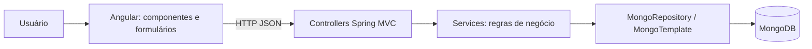

# Arquitetura e decisões

## Visão geral

O projeto usa uma API REST e uma interface separadas. A organização Java segue os domínios `collectionpoint` e `disposal`, com configurações, tipos compartilhados e tratamento de erros próprios. Não há necessidade de criar uma camada genérica adicional.

## Responsabilidades e orientação a objetos

| Elemento | Responsabilidade |
| --- | --- |
| `CollectionPointController`, `DisposalController` | Contrato HTTP, validação de entrada e status das respostas |
| `CollectionPointService` | Cadastro, consulta, edição e exclusão de pontos |
| `DisposalService` | Verificar o ponto e o material aceito, registrar, listar e excluir descartes |
| Interfaces `MongoRepository` | Persistência e consultas derivadas do nome do método |
| `MongoTemplate` | Edição atômica de um documento e carga condicional de demonstração |
| Records `CollectionPoint`, `Address`, `Disposal`, `DisposalRequest` | Representar dados com tipos definidos e estruturas compostas |
| `GlobalExceptionHandler` | Padronizar validações e falhas em respostas HTTP |
| Serviços Angular | Centralizar URLs, tipos e chamadas HTTP |
| Componentes Angular | Estado de carregamento, formulários, apresentação e ações |

Classes encapsulam responsabilidades e recebem dependências pelo construtor ou por injeção do Angular. As interfaces dos repositórios permitem substituir a persistência nos testes. Records são objetos de dados, e enums limitam materiais e unidades aceitos. `Clock` é injetado para permitir testar datas sem depender do relógio real.

## Fluxos principais

### Cadastro e edição do ponto

1. O formulário reativo exige campos de texto não vazios e ao menos um material.
2. No cadastro, envia `POST /api/collection-points` sem identidade definida pelo usuário.
3. Na edição, carrega o ponto pela rota e envia `PUT /api/collection-points/{id}`.
4. Bean Validation valida também o endereço aninhado; o ID usado é o da URL.
5. A edição atualiza somente os cinco campos de negócio com `findAndModify`, retornando o documento atualizado. Não usa upsert: um ponto excluído não é recriado pela edição.
6. O formulário volta aos detalhes após sucesso. Em erro, mantém os valores para nova tentativa.

A edição reaproveita o formulário, o modelo, os estilos e o serviço HTTP existentes. Os descartes não são regravados. Se um material for removido da lista aceita, os registros históricos permanecem e novos descartes desse material são rejeitados conforme a configuração consultada.

### Registro de descarte

1. O usuário escolhe um ponto e informa material, quantidade e unidade.
2. A API valida a quantidade e consulta o ponto.
3. O serviço rejeita material não aceito.
4. A API associa o ID da URL e usa a data informada ou o relógio do servidor.
5. O repositório grava o descarte; a interface atualiza a lista.

## Concorrência e recursos

- A edição de um ponto é uma única operação atômica em um documento MongoDB. Em duas edições concorrentes, a última gravação prevalece; não há controle de versão otimista nem mesclagem de campos.
- Não há leitura seguida de `save` no novo fluxo de edição, evitando recriar um ponto que acabou de ser excluído.
- O formulário bloqueia envio duplicado enquanto aguarda a API. `switchMap` cancela carregamentos antigos quando a rota muda; `takeUntilDestroyed` libera assinaturas ao destruir componentes. O envio da edição também é cancelado no cliente ao trocar de alvo.
- Cancelar HTTP no navegador não desfaz uma gravação que já chegou ao servidor. Consulte o ponto novamente para confirmar seu estado.
- O registro de descarte consulta o ponto antes de inserir em outra coleção. A exclusão remove descartes e depois o ponto. Esses fluxos preexistentes não têm transação entre coleções: alterações concorrentes podem gerar associação órfã ou usar materiais aceitos antes de uma edição. A PoC deve ser demonstrada com operações sequenciais. Uma versão multiusuário precisa revisar essa consistência com transações e estratégia de concorrência.
- Spring e o driver gerenciam as conexões MongoDB. Não foram introduzidas conexões, timers ou singletons manuais.

## Erros e segurança

- Validação de objetos aninhados, campos obrigatórios, enums e quantidade positiva no servidor.
- ID do corpo do ponto é somente leitura; criação gera identidade e edição usa a URL.
- Exclusão de descarte exige que ele pertença ao ponto indicado.
- Respostas 400, 404 e 503 não expõem credenciais ou detalhes internos do banco.
- CORS restrito à origem local configurada; inclui `PUT` para edição. CORS não substitui autenticação.
- Sem login, perfis de acesso ou autorização nesta PoC. Qualquer cliente com acesso à API pode modificar dados.
- Lista sem paginação e datas locais sem fuso no contrato atual: adequadas à demonstração pequena, exigem revisão antes de produção.

## Execução e rastreabilidade

Consulte o [README](../README.md), o [modelo NoSQL](banco-de-dados.md), o [contrato HTTP](api.md) e os [testes](testes.md). O marco inicial usado na comparação é `517c27ff8f3d60654604cb6b63077653b7cef8c0`, presente no histórico local antes desta etapa. A correspondência com o commit efetivamente enviado na primeira entrega deve ser confirmada pela equipe.
