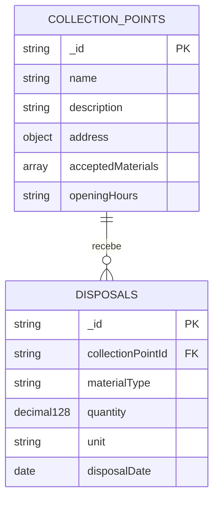

# Modelagem NoSQL

## Banco e coleções

Banco: `ecodescarte`. MongoDB armazena documentos BSON em duas coleções. Um ponto possui muitos descartes, relacionados por referência, e contém endereço aninhado e lista de materiais.



`FK` representa a associação lógica; MongoDB não impõe chave estrangeira. IDs automáticos podem ser persistidos como ObjectId pelo mapeamento do Spring, enquanto os IDs de demonstração são strings. A API representa IDs como strings.

## Exemplo de ponto

Exemplo BSON para `mongosh`, com identidade fictícia:

```javascript
{
    _id: 'demo-central',
    name: 'Eco Ponto Central',
    description: 'Ponto fictício para demonstração',
    address: {
        street: 'Avenida Brasil',
        number: '1000',
        neighborhood: 'Centro',
        city: 'Maringá',
        state: 'PR',
        zipCode: '87000-000'
    },
    acceptedMaterials: ['BATTERY', 'GLASS'],
    openingHours: '08:00 - 18:00'
}
```

O endereço é parte do ponto e normalmente é lido junto com ele; por isso fica embutido. A lista de materiais evita uma coleção adicional sem necessidade nesta PoC.

## Exemplo de descarte

```javascript
{
    _id: 'exemplo-descarte',
    collectionPointId: 'demo-central',
    materialType: 'BATTERY',
    quantity: NumberDecimal('10'),
    unit: 'UNITS',
    disposalDate: ISODate('2026-11-13T13:00:00Z')
}
```

O exemplo de data BSON é ilustrativo. O contrato HTTP recebe data local sem offset e o mapeamento usa o fuso da JVM; para reprodução, mantenha o mesmo fuso entre execuções. `BigDecimal` é armazenado como Decimal128, evitando perda de precisão na persistência de quantidades decimais. Documentos reais também podem conter metadados `_class` do Spring Data.

Descartes ficam em coleção separada para que o histórico cresça sem ampliar indefinidamente o documento do ponto. `collectionPointId` possui `@Indexed`; a criação automática de índices está habilitada em `application.yml`. O índice `_id` é gerenciado pelo MongoDB.

## Operações e integridade

- Cadastro: `insert` no repositório de pontos.
- Listagem de pontos: ordenação por nome.
- Edição: `findAndModify` pelo ID, sem upsert, alterando os campos do ponto em uma única operação.
- Registro: valida existência do ponto, material aceito e quantidade; grava o descarte.
- Histórico: consulta por `collectionPointId`, ordenada por `disposalDate` decrescente.
- Exclusão de descarte: consulta por ID e ponto; impede excluir descarte de outro ponto pela URL.
- Exclusão de ponto: remove seus descartes e depois o ponto. Não é transacional; ver [limites de concorrência](architecture.md).

A API aplica validação; os scripts não instalam um validador JSON Schema no banco. Escritas diretas pelo `mongosh` podem contornar as regras da aplicação.

## Consultas para demonstração manual

Com o banco da demonstração disponível, conecte pelo `mongosh` e execute:

```javascript
use ecodescarte
db.collection_points.find({}, { name: 1, address: 1, acceptedMaterials: 1 })
db.disposals.find({ collectionPointId: 'demo-central' }).sort({ disposalDate: -1 })
db.disposals.getIndexes()
```

Essas consultas são somente leitura. A inspeção precisa mostrar os documentos realmente criados no fluxo da aplicação.

## Aderência ao enunciado

O PDF identifica a turma como 6S, mas sua seção de evolução lista somente requisitos de 1º e 2º semestre. Esta solução cobre os requisitos explícitos ali descritos: NoSQL, CRUD dos pontos, múltiplas coleções, relacionamento, objeto aninhado e lista. Qualquer requisito adicional específico do 6º semestre precisa ser confirmado com o docente; não foi presumido.

Não é necessária migração para esta evolução: os campos e as coleções existentes foram preservados.
